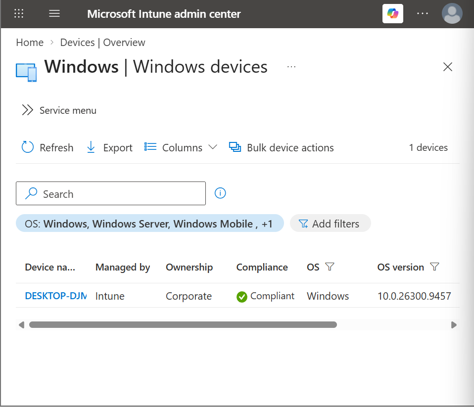
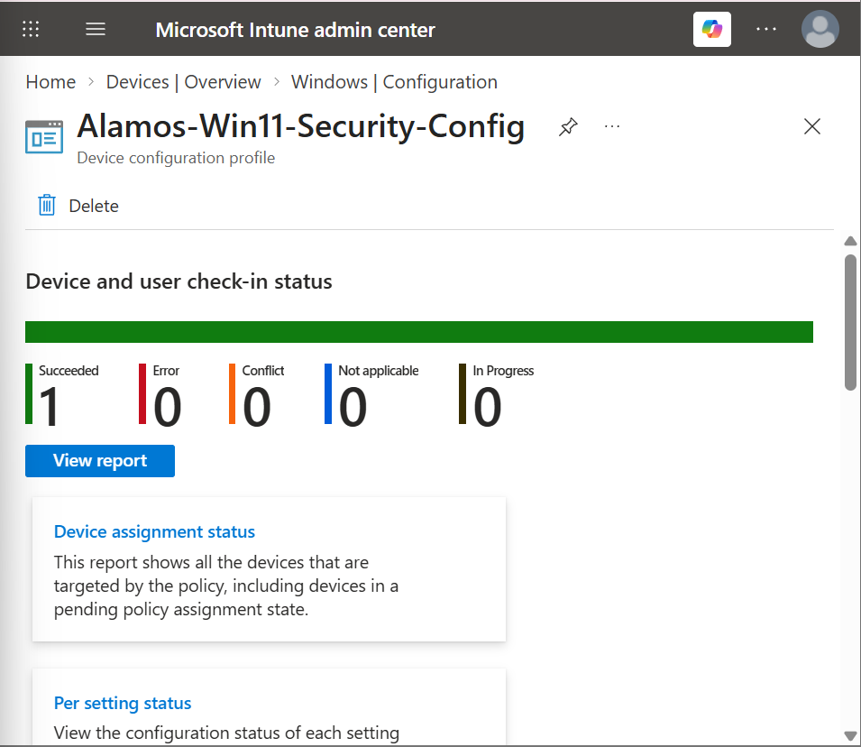
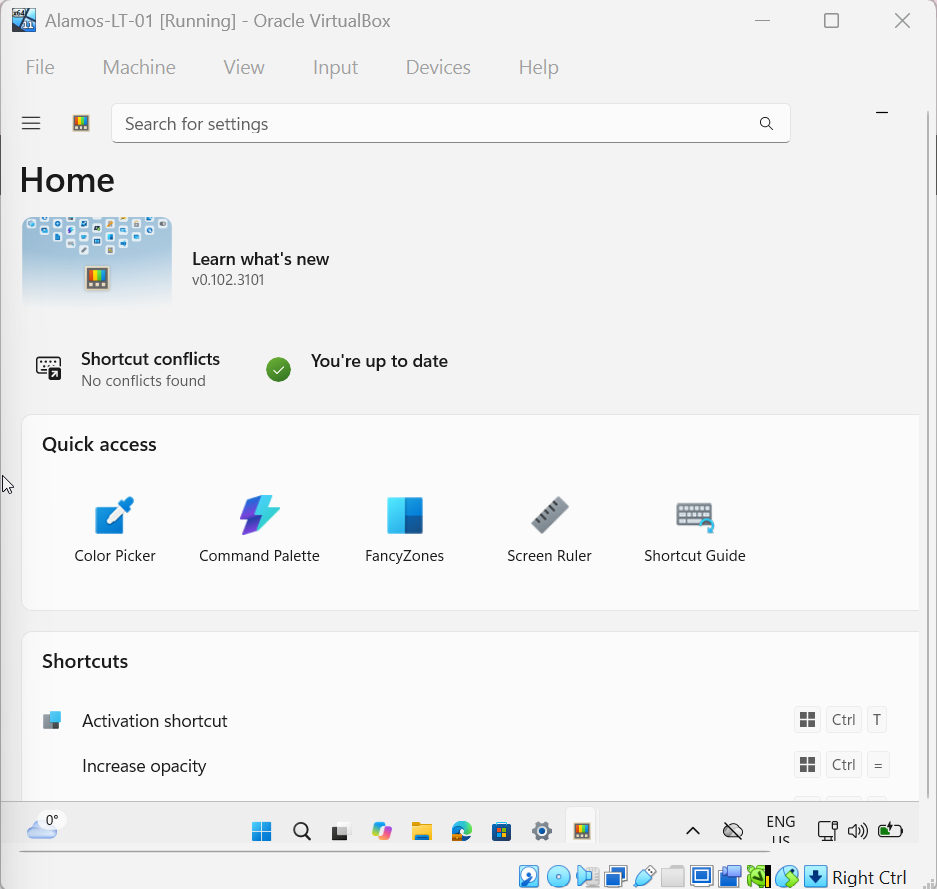
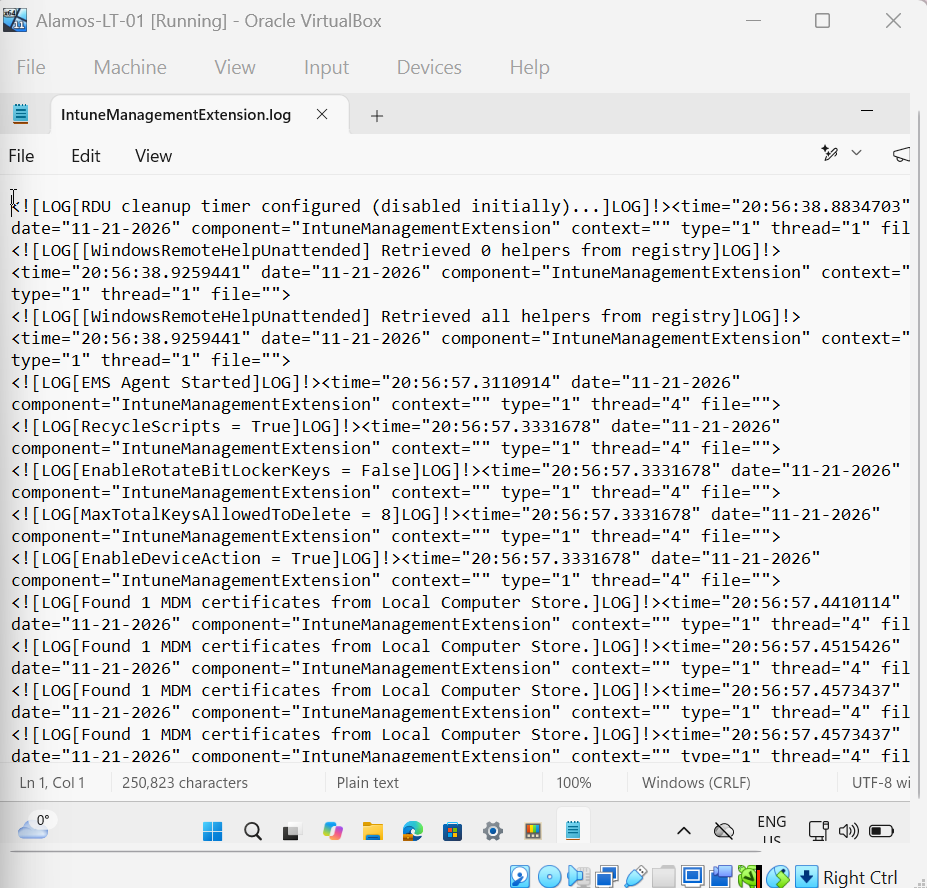

# Windows 11 Endpoint Management & Software Deployment Lab

## Project Overview
Simulated an end-to-end corporate device onboarding and endpoint management workflow using **Microsoft Intune**, **Microsoft Entra ID**, and **Windows 11**. Acting as an IT Technician preparing a new corporate laptop (`Corp-LT-01` / `DESKTOP-DJMG71H`), I configured MDM enrollment, enforced device compliance baselines, restricted removable storage via Settings Catalog, deployed applications silently, and verified client-side logs.

## Architecture & Technologies Used
* **Cloud MDM & Identity:** Microsoft Intune, Microsoft Entra ID (Automatic MDM Enrollment)
* **Endpoint OS:** Windows 11 (TPM 2.0, EFI, and Secure Boot enabled)
* **Virtualization:** Oracle VirtualBox

---

## Lab Implementation Phases

### 1. Environment Preparation & MDM Enrollment
* Provisioned a Windows 11 virtual workstation (`Corp-LT-01`) with hardware security prerequisites (TPM 2.0 and Secure Boot) enabled.
* Configured Automatic MDM Enrollment in Microsoft Entra ID and joined the endpoint to Intune under a corporate test identity (`alex.smith`).

### 2. Device Compliance Policy (`Corp-Win11-Security-Compliance`)
* Created and assigned a Windows 10/11 compliance policy requiring **Secure Boot**, **Windows Firewall**, **Antivirus**, and **Antispyware** protection.
* Triggered an MDM policy sync and verified the endpoint transitioned to a **Compliant** state.

### 3. Security Configuration Profile (`Corp-Win11-Security-Config`)
* Built a **Settings Catalog** configuration profile enforcing `All Removable Storage classes: Deny all access` to prevent unauthorized USB data transfer on corporate laptops.
* Assigned the profile to all corporate devices and verified **Succeeded** check-in telemetry.

### 4. Remote Software Deployment
* Configured and assigned **Microsoft PowerToys** and **Company Portal** as required applications via Intune (`Microsoft Store app (new)`).
* Verified silent background installation (`Microsoft Intune Management Extension: EnforcementCompleted`) and confirmed application launch on the endpoint.

### 5. Endpoint Troubleshooting & Log Verification
* Investigated sync intervals and background Win32/Store app queue behavior during initial provisioning.
* Inspected client-side deployment telemetry in `C:\ProgramData\Microsoft\IntuneManagementExtension\Logs\IntuneManagementExtension.log` to confirm policy enforcement.

---

## Key Skills Demonstrated
* Cloud Endpoint Management (Microsoft Intune & Entra ID)
* Device Compliance & Security Baseline Enforcement
* Settings Catalog & Configuration Profile Administration
* Silent Remote Application Deployment
* Client-Side MDM Sync & Intune Management Extension Log Troubleshooting
